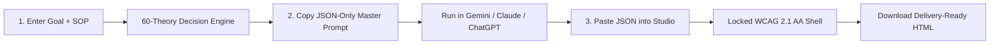

<div align="center">
  

  <a href="https://linuxsunil.github.io/gemini-notebook-actionmap-prompt-studio/">
    
  </a>

  <p>
    <a href="https://linuxsunil.github.io/gemini-notebook-actionmap-prompt-studio/">
      
    </a>
    
    
    
  </p>
</div>

---

> Turn any SOP, policy, or SME notes into a delivery-ready, theory-grounded workplace simulation—without letting AI invent broken CSS or forcing non-technical instructional designers to edit code.

**Audience:** Instructional designers, L&D leads, and eLearning developers who want the speed of AI authoring (Gemini Notebook, Claude, ChatGPT) with the rigour of instructional design science and guaranteed UI quality.

---

## Why This Exists

AI tools like **Gemini Notebook** can generate standalone interactive HTML pages in minutes. That solves *authoring speed*, but creates two real-world L&D problems:

1. **Pedagogical default:** Given a standard prompt, AI defaults to passive study guides—upfront content dumps, flip cards, and `"Correct / Incorrect"` recall quizzes.
2. **Layout fragility:** When an LLM writes both the content and the CSS from scratch, overflowing badges, clipped text, and inconsistent accessibility are inevitable. Non-technical IDs should never have to debug CSS to ship a module.

**ActionMap Prompt Studio** fixes both by separating **instructional intelligence** from **presentation**:
- The **AI** acts strictly as the Learning Architect, outputting structured **JSON only**.
- The **Studio** owns a **Locked WCAG 2.1 AA Course Shell** that renders that JSON into a clean, delivery-ready `.html` file every single time.

---

## How It Works



### Quick Start (No Coding Required)

1. Open the **[Live Studio](https://linuxsunil.github.io/gemini-notebook-actionmap-prompt-studio/)**.
2. **Step 1:** Choose a performance goal (or click a preset). The engine automatically selects the **Primary & Secondary ID Theories** from the 60-theory library and embeds Revised Bloom's verb rules and Grade 8 readability guardrails.
3. **Step 2:** Click **Copy Master Prompt** and paste it into Gemini, Claude, or ChatGPT.
4. **Step 3:** Paste the AI's JSON response back into the Studio, click **Render Live Preview**, and click **Download Delivery-Ready HTML**.

> **Want to test it in 5 seconds?** Open the live link, scroll to Step 3, and click **Load Sample JSON (Instant Demo)**.

---

## Side-by-Side Live Proof

Tab 2 of the Studio hosts two real `.html` files exported from Gemini Notebook using the **exact same 1-page source document** (`SOP-SEC-04: Phishing & Data Privacy Response`):

| Dimension | Passive Study Page (`demos/passive-study-page.html`) | Action-Mapped Simulation (`demos/action-mapped-sim.html`) |
| :--- | :--- | :--- |
| **Opening** | Policy summary & KPI blocks | Drops learner straight into an urgent spoofed CEO email |
| **Interactivity** | Flip cards & click-to-reveal Do/Don't panels | Inspectable mail headers, link/attachment traps, Slack triage |
| **Feedback** | `"Correct"` / `"Incorrect"` recall grading | Realistic workplace consequence timelines (`T+01 min`, `T+06 min`) |
| **Policy Reference** | Memorised upfront | Collapsible **SOP Quick-Reference** drawer used only on demand |
| **Debrief** | Percentage quiz score | Habit-based **Incident Readiness Summary** |

---

## Repository Structure

```text
gemini-notebook-actionmap-prompt-studio/
├── index.html                  # 3-Step Course Builder + Side-by-Side Live Proof UI
├── theories.js                 # 60-Theory ID Library + Goal-to-Theory Decision Matrix
├── shell-template.js           # Locked, WCAG 2.1 AA-compliant HTML/CSS/JS Course Shell
├── README.md                   # Project documentation
└── demos/
    ├── passive-study-page.html # Raw Gemini Notebook export (Standard study prompt)
    └── action-mapped-sim.html  # Raw Gemini Notebook export (Action-Mapped prompt)
```

---

## Tech Approach

- **Vanilla HTML, CSS, and JavaScript** — zero frameworks, zero build step, zero npm dependencies.
- **100% Client-Side & Zero-Server** — runs directly in the browser or on GitHub Pages with no backend and no API keys.
- **Standardised Output** — every exported simulation is a single, self-contained `.html` file ready for web hosting, Rise 360 Embed blocks, or SCORM wrapping.

---

## About the Author

[Sunil Iyer](https://www.linkedin.com/in/sunil-iyer-b545964/) is a Senior Instructional Designer with 10+ years of experience building eLearning for global organisations. He specialises in AI-powered course development, SCORM/xAPI, and Articulate Rise 360 / Storyline 360.

[GitHub](https://github.com/linuxsunil) · [LinkedIn](https://www.linkedin.com/in/sunil-iyer-b545964/)

<div align="center">
  
</div>